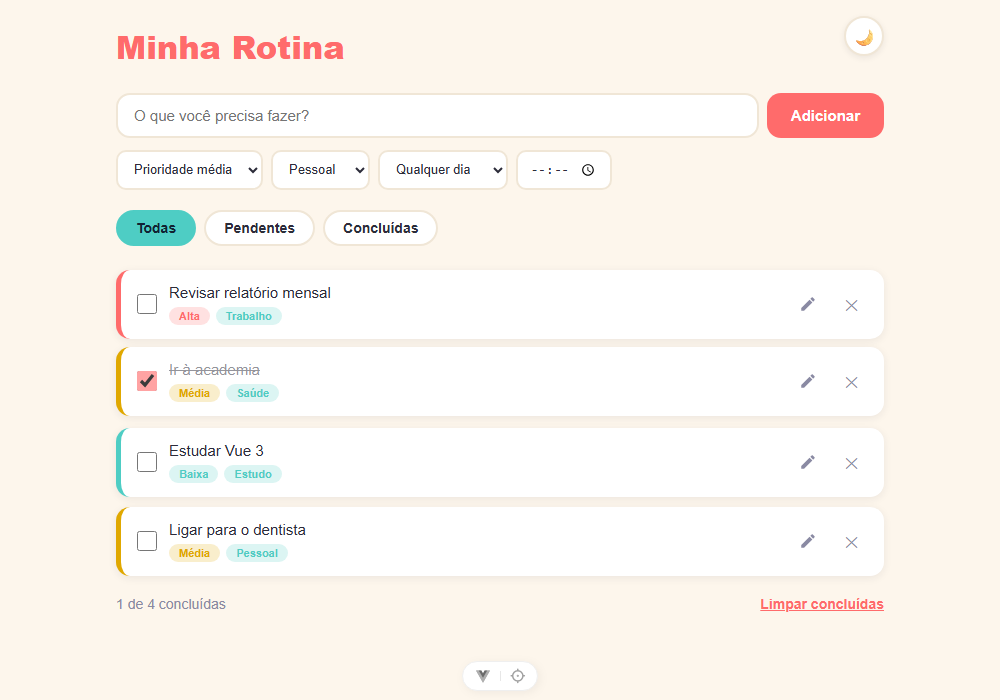

# Minha Rotina

Aplicação de lista de tarefas (to-do list) e hábitos, construída com Vue 2, TypeScript (class components) e Vuex. Permite criar tarefas com prioridade, categoria e agendamento (dia da semana / horário), marcar como concluídas, editar, filtrar, alternar entre tema claro e escuro, e acompanhar hábitos diários com streak.

Link do site: https://projeto-minha-rotina-xp2t.vercel.app/



## Funcionalidades

- Criar tarefas com texto, prioridade (baixa/média/alta), categoria (trabalho, casa, saúde, estudo, pessoal, outro) e agendamento opcional (dia da semana ou data específica, e horário)
- Marcar/desmarcar tarefas como concluídas
- Editar o texto de uma tarefa existente
- Filtrar por todas, pendentes ou concluídas
- Limpar todas as tarefas concluídas de uma vez
- Hábitos diários (rota `/habitos`): criar hábito com nome, emoji e dias da semana; marcar conclusão do dia com streak (sequência de dias) e barra de progresso
- Alternar entre tema claro e escuro (persistido e sincronizado com o tema do Vuetify)

## Tecnologias

- [Vue 2](https://v2.vuejs.org/) com class components (`vue-class-component` + `vue-property-decorator`)
- [TypeScript](https://www.typescriptlang.org/)
- [Vue CLI](https://cli.vuejs.org/) (`@vue/cli-service`)
- [Vuex](https://vuex.vuejs.org/) para gerenciamento de estado, um módulo por domínio (`tasks`, `habits`, `theme`)
- [Vue Router](https://v3.router.vuejs.org/)
- [Vuetify 2](https://v2.vuetifyjs.com/) para os componentes de UI e tema
- [ESLint](https://eslint.org/) (`@vue/eslint-config-airbnb` + `@vue/eslint-config-typescript`) + [Jest](https://jestjs.io/) (`@vue/test-utils`)

> Este projeto não tem backend: toda a persistência é feita via `localStorage`, através da camada de serviços (`*.service.ts`). Por isso não existe uma camada `http.service.ts`/axios — ela não se aplica aqui.

## Como executar

Pré-requisitos: Node.js `^20.19.0` ou `>=22.12.0`.

```sh
npm install
```

### Ambiente de desenvolvimento (hot-reload)

```sh
npm run serve
```

### Build de produção

```sh
npm run build
```

### Lint

```sh
npm run lint
```

### Testes unitários

```sh
npm run test:unit
```

### Formatação (opcional, local)

```sh
npm run format
```

## Estrutura do projeto

```
src/
├── app.vue                 # Shell raiz (v-app, nav-bar, router-view)
├── main.ts                 # Bootstrap: new Vue({ router, store, vuetify, ... })
├── router/                 # Agrega o route.ts de cada módulo
├── store/                  # Vuex: um módulo por domínio
│   ├── index.ts
│   ├── mutations.enum.ts   # Enum global de nomes de mutation
│   ├── tasks/               # state.ts, getters.ts, actions.ts, mutations.ts
│   ├── habits/
│   └── theme/
├── plugins/
│   └── vuetify.ts           # Tema (cores) do Vuetify
├── components/
│   └── nav-bar.component.vue
└── modules/
    ├── Tasks/
    │   ├── Tasks.vue                     # Tela principal de tarefas
    │   ├── route.ts                      # Rota "/"
    │   ├── components/                   # Componentes internos + entities/interfaces
    │   └── services/                     # task.service.ts (localStorage)
    └── Habits/
        ├── Habits.vue                    # Tela de hábitos do dia
        ├── route.ts                      # Rota "/habitos"
        ├── components/                   # entities/interfaces
        └── services/                     # habit.service.ts (localStorage)
```

> Termos e nomes usados no código (variáveis, tipos, componentes) são mantidos em inglês; todo o texto exibido ao usuário na interface está em português.
